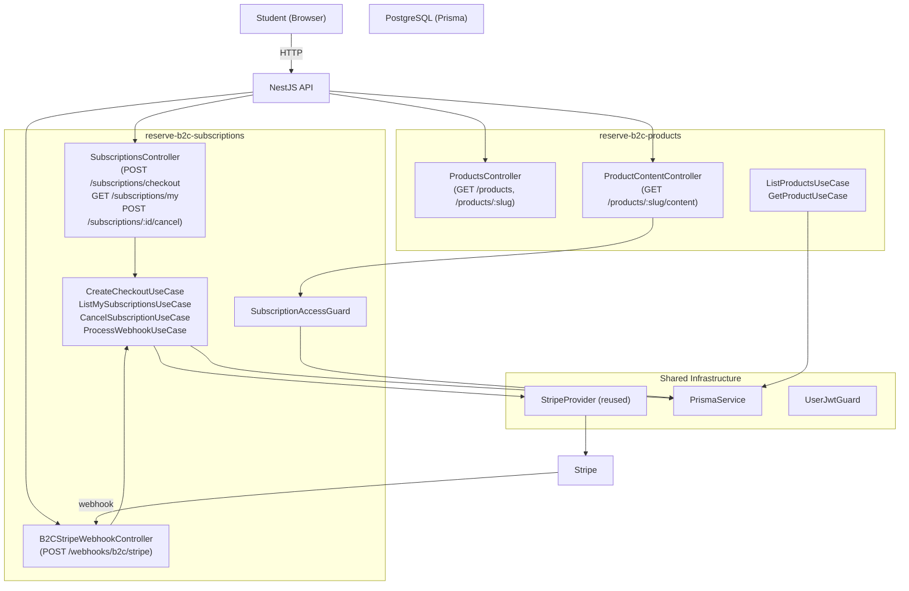
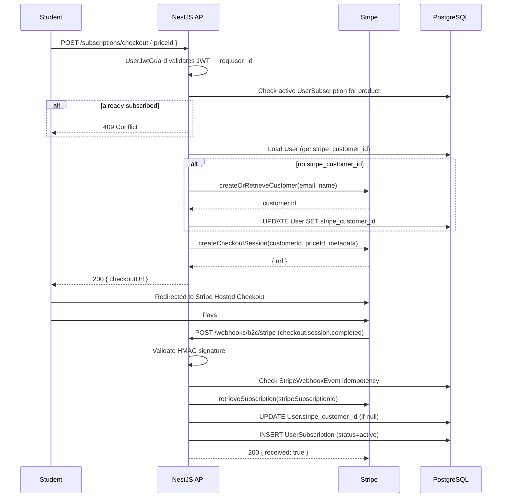
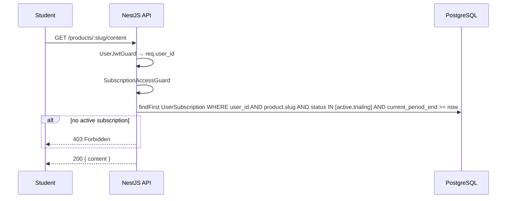
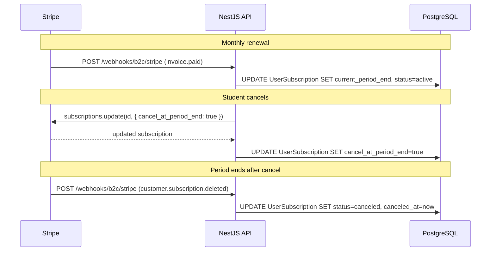

# Design Document: B2C Student Subscriptions

## Overview

This feature introduces a B2C subscription system for students (end-users) in an educational institution platform. Unlike the existing B2B system where tenants/organizations subscribe, here each student purchases access to individual products (courses/content) directly via Stripe Hosted Checkout. Access is granted while the subscription is active and automatically revoked when it expires or is canceled.

The system is implemented as two new bounded context modules — `reserve-b2c-products` and `reserve-b2c-subscriptions` — following the project's DDD/`reserve-*` pattern. The existing `reserve-subscriptions` (B2B) module is left untouched.

## Architecture



## Sequence Diagrams

### Checkout Flow



### Content Access Flow



### Renewal & Cancellation Flow



## Components and Interfaces

### Module: `reserve-b2c-products`

**Purpose**: Product catalog — lists active products and their prices. Read-only from the student's perspective; products are managed in Stripe Dashboard and synced via the Prisma schema.

**Interface**:
```typescript
interface IProductRepository {
  findAllActive(): Promise<ProductEntity[]>
  findBySlug(slug: string): Promise<ProductEntity | null>
}

interface IProductPriceRepository {
  findActiveByProductId(productId: string): Promise<ProductPriceEntity[]>
  findByStripePriceId(stripePriceId: string): Promise<ProductPriceEntity | null>
}
```

**Responsibilities**:
- Expose `GET /products` — list active products with their active prices
- Expose `GET /products/:slug` — single product detail with prices
- Expose `GET /products/:slug/content` — gated behind `UserJwtGuard + SubscriptionAccessGuard`

---

### Module: `reserve-b2c-subscriptions`

**Purpose**: Checkout initiation, subscription lifecycle management, webhook processing, and access guard.

**Interface**:
```typescript
interface IUserSubscriptionRepository {
  create(data: CreateUserSubscriptionData): Promise<UserSubscriptionEntity>
  findById(id: string): Promise<UserSubscriptionEntity | null>
  findByStripeSubscriptionId(stripeSubId: string): Promise<UserSubscriptionEntity | null>
  findAllByUserId(userId: string): Promise<UserSubscriptionEntity[]>
  hasActiveSubscription(userId: string, productSlug: string): Promise<boolean>
  updateByStripeSubscriptionId(stripeSubId: string, data: UpdateUserSubscriptionData): Promise<void>
}

interface IB2CStripeWebhookEventRepository {
  existsByStripeEventId(stripeEventId: string): Promise<boolean>
  create(data: CreateWebhookEventData): Promise<void>
}
```

**Responsibilities**:
- `CreateCheckoutSessionUseCase` — validates, creates Stripe customer if needed, creates checkout session
- `ListMySubscriptionsUseCase` — returns all subscriptions for the authenticated student
- `CancelSubscriptionUseCase` — sets `cancel_at_period_end = true` via Stripe API
- `ProcessB2CWebhookUseCase` — handles all 5 Stripe events with idempotency
- `SubscriptionAccessGuard` — checks active subscription for a product slug

---

### Guard: `SubscriptionAccessGuard`

**Purpose**: Protects product content routes. Reads `req.user_id` (set by `UserJwtGuard`) and `req.params.slug`.

**Interface**:
```typescript
interface CanActivate {
  canActivate(context: ExecutionContext): Promise<boolean>
}
```

**Access logic**:
```typescript
// A subscription grants access when:
function isSubscriptionActive(sub: UserSubscription): boolean {
  const now = new Date();
  const isActiveStatus = ['active', 'trialing'].includes(sub.status);
  const isWithinPeriod = now <= sub.current_period_end;
  const isCanceledButStillValid =
    sub.cancel_at_period_end && sub.status === 'active' && isWithinPeriod;
  return (isActiveStatus && isWithinPeriod) || isCanceledButStillValid;
}
```

## Data Models

### Prisma Schema Additions

#### `User` model — add `stripe_customer_id` field

```prisma
model User {
  // ... existing fields ...
  stripe_customer_id String? @unique @db.VarChar(100)

  UserSubscription   UserSubscription[]
}
```

#### `Product` — new model

```prisma
model Product {
  id                String   @id @default(cuid()) @db.VarChar(25)
  stripe_product_id String   @unique @db.VarChar(100)
  name              String   @db.VarChar(255)
  description       String?  @db.Text
  slug              String   @unique @db.VarChar(100)
  active            Boolean  @default(true)
  created_at        DateTime @default(now())
  updated_at        DateTime @updatedAt

  ProductPrice     ProductPrice[]
  UserSubscription UserSubscription[]
}
```

#### `ProductPrice` — new model

```prisma
model ProductPrice {
  id              String   @id @default(cuid()) @db.VarChar(25)
  stripe_price_id String   @unique @db.VarChar(100)
  product_id      String   @db.VarChar(25)
  Product         Product  @relation(fields: [product_id], references: [id])
  interval        String   @db.VarChar(20)   // month | year | week
  interval_count  Int      @default(1)       @db.SmallInt
  unit_amount     Int                        // cents
  currency        String   @default("brl")   @db.VarChar(3)
  active          Boolean  @default(true)
  created_at      DateTime @default(now())
  updated_at      DateTime @updatedAt

  UserSubscription UserSubscription[]
}
```

#### `UserSubscription` — new model

```prisma
model UserSubscription {
  id                     String   @id @default(cuid()) @db.VarChar(25)
  user_id                String   @db.VarChar(25)
  User                   User     @relation(fields: [user_id], references: [id])
  product_id             String   @db.VarChar(25)
  Product                Product  @relation(fields: [product_id], references: [id])
  product_price_id       String   @db.VarChar(25)
  ProductPrice           ProductPrice @relation(fields: [product_price_id], references: [id])

  // Stripe identifiers
  stripe_subscription_id String   @unique @db.VarChar(100)
  stripe_customer_id     String   @db.VarChar(100)
  stripe_price_id        String   @db.VarChar(100)

  // Status: active | trialing | past_due | canceled | incomplete | unpaid
  status                 String   @db.VarChar(50)

  // Period
  current_period_start   DateTime
  current_period_end     DateTime
  trial_start            DateTime?
  trial_end              DateTime?
  canceled_at            DateTime?
  cancel_at_period_end   Boolean  @default(false)

  // Financial
  amount                 Int      // cents
  currency               String   @default("brl") @db.VarChar(3)

  created_at             DateTime @default(now())
  updated_at             DateTime @updatedAt

  @@index([user_id, status])
  @@index([stripe_subscription_id])
}
```

> `StripeWebhookEvent` already exists in the schema and is reused as-is for idempotency.

### Domain Entities

#### `ProductEntity`

```typescript
interface ProductProps {
  id: string
  stripeProductId: string
  name: string
  description?: string
  slug: string
  active: boolean
  prices: ProductPriceEntity[]
  createdAt: Date
  updatedAt: Date
}
```

#### `ProductPriceEntity`

```typescript
interface ProductPriceProps {
  id: string
  stripePriceId: string
  productId: string
  interval: 'month' | 'year' | 'week'
  intervalCount: number
  unitAmount: number   // cents
  currency: string
  active: boolean
}
```

#### `UserSubscriptionEntity`

```typescript
interface UserSubscriptionProps {
  id: string
  userId: string
  productId: string
  productPriceId: string
  stripeSubscriptionId: string
  stripeCustomerId: string
  stripePriceId: string
  status: EUserSubscriptionStatus
  currentPeriodStart: Date
  currentPeriodEnd: Date
  trialStart?: Date
  trialEnd?: Date
  canceledAt?: Date
  cancelAtPeriodEnd: boolean
  amount: number
  currency: string
  createdAt: Date
  updatedAt: Date
}

// Business method on entity:
isActive(): boolean  // encapsulates the access logic
```

#### `EUserSubscriptionStatus` enum

```typescript
enum EUserSubscriptionStatus {
  ACTIVE = 'active',
  TRIALING = 'trialing',
  PAST_DUE = 'past_due',
  CANCELED = 'canceled',
  INCOMPLETE = 'incomplete',
  UNPAID = 'unpaid',
}
```

## Key Functions with Formal Specifications

### `CreateCheckoutSessionUseCase.execute()`

```typescript
async execute(dto: { userId: string; priceId: string }): Promise<{ checkoutUrl: string }>
```

**Preconditions:**
- `dto.userId` is a valid existing User id
- `dto.priceId` is a valid `ProductPrice.id` (internal id, not Stripe price id)
- The `ProductPrice` and its parent `Product` are `active = true`
- No active `UserSubscription` exists for this user + product combination

**Postconditions:**
- Returns a `checkoutUrl` pointing to Stripe Hosted Checkout
- If `User.stripe_customer_id` was null, it is now persisted
- No `UserSubscription` is created yet (created by webhook)

**Error cases:**
- `NotFoundException` — price not found or inactive
- `ConflictException` — student already has an active subscription for this product

---

### `ProcessB2CWebhookUseCase.execute()`

```typescript
async execute(event: Stripe.Event): Promise<void>
```

**Preconditions:**
- `event.id` has not been processed before (idempotency check via `StripeWebhookEvent`)
- HMAC signature was already validated by the controller before calling this use case

**Postconditions (per event type):**

| Event | Postcondition |
|---|---|
| `checkout.session.completed` | `UserSubscription` created; `User.stripe_customer_id` saved |
| `customer.subscription.updated` | `UserSubscription.status`, `current_period_end`, `cancel_at_period_end` updated |
| `customer.subscription.deleted` | `UserSubscription.status = 'canceled'`, `canceled_at = now` |
| `invoice.paid` | `UserSubscription.current_period_end` updated, `status = 'active'` |
| `invoice.payment_failed` | `UserSubscription.status = 'past_due'` |

**Loop invariant:** Each event type handler is idempotent — re-processing the same `stripe_event_id` is a no-op.

---

### `SubscriptionAccessGuard.canActivate()`

```typescript
async canActivate(context: ExecutionContext): Promise<boolean>
```

**Preconditions:**
- `UserJwtGuard` has already run and set `req.user_id`
- Route has `:slug` param identifying the product

**Postconditions:**
- Returns `true` if `hasActiveSubscription(userId, slug)` is true
- Throws `ForbiddenException` otherwise

**Access predicate (enforced in repository query):**
```
status IN ('active', 'trialing')
AND current_period_end >= NOW()
```
> `cancel_at_period_end = true` with `status = 'active'` still satisfies the above — access is preserved until the period ends.

---

### `CancelSubscriptionUseCase.execute()`

```typescript
async execute(dto: { subscriptionId: string; userId: string }): Promise<void>
```

**Preconditions:**
- `UserSubscription` with `id = subscriptionId` exists and belongs to `userId`
- `status` is `active` or `trialing`

**Postconditions:**
- Stripe subscription updated with `cancel_at_period_end = true`
- Local `UserSubscription.cancel_at_period_end = true`
- Student retains access until `current_period_end`

**Error cases:**
- `NotFoundException` — subscription not found or does not belong to user
- `BadRequestException` — subscription is already canceled

## Webhook Event Handling

### Events and Actions

| Stripe Event | Handler Method | DB Action |
|---|---|---|
| `checkout.session.completed` | `handleCheckoutCompleted` | INSERT `UserSubscription`; UPDATE `User.stripe_customer_id` |
| `customer.subscription.updated` | `handleSubscriptionUpdated` | UPDATE status, period, `cancel_at_period_end` |
| `customer.subscription.deleted` | `handleSubscriptionDeleted` | UPDATE `status = 'canceled'`, `canceled_at = now` |
| `invoice.paid` | `handleInvoicePaid` | UPDATE `current_period_end`, `status = 'active'` |
| `invoice.payment_failed` | `handleInvoicePaymentFailed` | UPDATE `status = 'past_due'` |

### Idempotency Pattern

```typescript
// In ProcessB2CWebhookUseCase
const alreadyProcessed = await this.webhookEventRepo.existsByStripeEventId(event.id);
if (alreadyProcessed) return; // no-op

await this.webhookEventRepo.create({ stripeEventId: event.id, eventType: event.type, payload: event });

switch (event.type) {
  case 'checkout.session.completed': ...
  case 'customer.subscription.updated': ...
  // etc.
}
```

### Raw Body Configuration (main.ts)

```typescript
// Required for Stripe HMAC signature validation
app.use(
  '/webhooks/b2c/stripe',
  json({
    verify: (req: any, _res, buf) => {
      req.rawBody = buf;
    },
  }),
);
```

## API Endpoints

| Method | Route | Guard | Use Case |
|---|---|---|---|
| `GET` | `/products` | Public | `ListProductsUseCase` |
| `GET` | `/products/:slug` | Public | `GetProductUseCase` |
| `GET` | `/products/:slug/content` | `UserJwtGuard` + `SubscriptionAccessGuard` | — |
| `POST` | `/subscriptions/checkout` | `UserJwtGuard` | `CreateCheckoutSessionUseCase` |
| `GET` | `/subscriptions/my` | `UserJwtGuard` | `ListMySubscriptionsUseCase` |
| `POST` | `/subscriptions/:id/cancel` | `UserJwtGuard` | `CancelSubscriptionUseCase` |
| `POST` | `/webhooks/b2c/stripe` | Stripe HMAC | `ProcessB2CWebhookUseCase` |

## Module Structure

```
src/modules/
├── reserve-b2c-products/
│   ├── reserve-b2c-products.module.ts
│   ├── domain/
│   │   ├── entities/
│   │   │   ├── product.entity.ts
│   │   │   └── product-price.entity.ts
│   │   └── interfaces/
│   │       ├── product.repository.interface.ts
│   │       └── product-price.repository.interface.ts
│   ├── application/
│   │   ├── use-cases/
│   │   │   ├── list-products.use-case.ts
│   │   │   └── get-product.use-case.ts
│   │   └── dtos/
│   │       └── product-response.dto.ts
│   └── infrastructure/
│       ├── controllers/
│       │   └── products.controller.ts
│       └── repositories/
│           ├── prisma-product.repository.ts
│           └── prisma-product-price.repository.ts
│
└── reserve-b2c-subscriptions/
    ├── reserve-b2c-subscriptions.module.ts
    ├── domain/
    │   ├── entities/
    │   │   └── user-subscription.entity.ts
    │   ├── enums/
    │   │   └── user-subscription-status.enum.ts
    │   └── interfaces/
    │       ├── user-subscription.repository.interface.ts
    │       └── b2c-stripe-webhook-event.repository.interface.ts
    ├── application/
    │   ├── use-cases/
    │   │   ├── create-checkout-session.use-case.ts
    │   │   ├── list-my-subscriptions.use-case.ts
    │   │   ├── cancel-subscription.use-case.ts
    │   │   └── process-b2c-webhook.use-case.ts
    │   └── dtos/
    │       ├── create-checkout-session.dto.ts
    │       └── user-subscription-response.dto.ts
    └── infrastructure/
        ├── controllers/
        │   ├── b2c-subscriptions.controller.ts
        │   └── b2c-stripe-webhook.controller.ts
        ├── guards/
        │   └── subscription-access.guard.ts
        └── repositories/
            ├── prisma-user-subscription.repository.ts
            └── prisma-b2c-stripe-webhook-event.repository.ts
```

## Error Handling

### Checkout Errors

| Condition | Response |
|---|---|
| Price not found or inactive | `404 Not Found` |
| Student already subscribed to product | `409 Conflict` |
| Stripe API failure | `502 Bad Gateway` (wrapped provider exception) |

### Webhook Errors

| Condition | Response |
|---|---|
| Missing `stripe-signature` header | `400 Bad Request` |
| Invalid HMAC signature | `400 Bad Request` |
| Missing metadata (`userId`, `productId`, `priceId`) | Log error + `400` (Stripe will retry) |
| Duplicate event (idempotency) | `200 OK` (no-op) |

### Content Access Errors

| Condition | Response |
|---|---|
| No JWT / invalid JWT | `401 Unauthorized` (UserJwtGuard) |
| No active subscription | `403 Forbidden` (SubscriptionAccessGuard) |

## Testing Strategy

### Unit Testing

- `UserSubscriptionEntity.isActive()` — test all status/period combinations
- `CreateCheckoutSessionUseCase` — mock `IUserSubscriptionRepository`, `IStripeProvider`, `IUserRepository`
- `ProcessB2CWebhookUseCase` — test each event type handler in isolation; test idempotency (second call is no-op)
- `CancelSubscriptionUseCase` — test ownership check, already-canceled guard
- `SubscriptionAccessGuard` — test active/trialing/past_due/canceled/expired scenarios

### Property-Based Testing

**Property Test Library**: `fast-check`

- `isActive()` is `true` if and only if `status ∈ {active, trialing}` AND `current_period_end >= now`
- `cancel_at_period_end = true` with `status = active` and `current_period_end >= now` → `isActive() = true`
- Idempotency: processing the same webhook event N times produces the same DB state as processing it once

### Integration Testing

- `PrismaUserSubscriptionRepository.hasActiveSubscription()` — test with real DB rows covering all status/date combinations
- Webhook controller signature validation — test with valid and tampered raw bodies

## Security Considerations

- **Webhook HMAC**: Always validate `stripe-signature` using `STRIPE_WEBHOOK_SECRET` before processing any event. Never trust event data without signature verification.
- **Ownership enforcement**: `CancelSubscriptionUseCase` must verify `UserSubscription.user_id === req.user_id` before calling Stripe. Never allow a student to cancel another student's subscription.
- **Metadata integrity**: `checkout.session.completed` handler must validate that `userId`, `productId`, and `priceId` from metadata correspond to real, active records before creating a `UserSubscription`.
- **No frontend trust**: Content access is always enforced server-side via `SubscriptionAccessGuard`. Frontend UI hiding is cosmetic only.
- **`stripe_customer_id` deduplication**: Always check `User.stripe_customer_id` before calling `createOrRetrieveCustomer` to avoid duplicate Stripe customers.

## Performance Considerations

- `@@index([user_id, status])` on `UserSubscription` ensures the access guard query is fast even with many subscriptions per user.
- `@@index([stripe_subscription_id])` ensures webhook lookups by Stripe ID are O(log n).
- `StripeWebhookEvent` idempotency check is a single indexed unique lookup — negligible overhead.
- `User.stripe_customer_id` is cached on the User row to avoid a Stripe API call on every checkout.

## Dependencies

### New Environment Variables

```env
STRIPE_SECRET_KEY=sk_live_...          # already exists (shared with B2B)
STRIPE_WEBHOOK_SECRET=whsec_...        # already exists (B2B uses per-tenant; B2C uses this global one)
STRIPE_PUBLISHABLE_KEY=pk_live_...     # returned to frontend for checkout
FRONTEND_URL=https://www.seusite.com   # for success/cancel redirect URLs
```

> The B2C webhook uses the global `STRIPE_WEBHOOK_SECRET` env var (single Stripe account), unlike the B2B system which uses per-tenant secrets stored in `TenantBillingConfig`.

### Reused Infrastructure

- `StripeProvider` from `reserve-subscriptions` — injected via `STRIPE_PROVIDER` token; no modifications needed
- `StripeWebhookEvent` Prisma model — reused as-is for idempotency
- `UserJwtGuard` from `shared/auth/guards/user-jwt.guard.ts`
- `PrismaService` from `shared/database/`

### New Prisma Models

- `Product`
- `ProductPrice`
- `UserSubscription`
- `User.stripe_customer_id` field (migration required)


## Correctness Properties

*A property is a characteristic or behavior that should hold true across all valid executions of a system — essentially, a formal statement about what the system should do. Properties serve as the bridge between human-readable specifications and machine-verifiable correctness guarantees.*

### Property 1: Active product catalog filtering

*For any* set of Product records in the database, `ListProductsUseCase` SHALL return only those Products where `active = true`, each containing only `ProductPrice` records where `active = true`.

**Validates: Requirements 1.1**

---

### Property 2: Product slug lookup round-trip

*For any* active Product stored in the database, fetching it by its `slug` via `GetProductUseCase` SHALL return a Product whose `slug`, `id`, and `name` are identical to the stored record.

**Validates: Requirements 1.2**

---

### Property 3: Checkout creates customer when absent

*For any* Student with `stripe_customer_id = null`, executing `CreateCheckoutSessionUseCase` with a valid `priceId` SHALL result in the Student's `User` record having a non-null `stripe_customer_id` after the use case completes.

**Validates: Requirements 2.2**

---

### Property 4: Checkout rejects duplicate active subscription

*For any* Student who already has a `UserSubscription` satisfying the active access predicate for a given Product, executing `CreateCheckoutSessionUseCase` for any `ProductPrice` of that Product SHALL throw a `ConflictException`.

**Validates: Requirements 2.4**

---

### Property 5: Webhook idempotency

*For any* Stripe event, processing it N times (N ≥ 1) via `ProcessB2CWebhookUseCase` SHALL produce the same database state as processing it exactly once — subsequent calls with the same `stripe_event_id` are no-ops.

**Validates: Requirements 3.8, 3.9**

---

### Property 6: Webhook event handlers update subscription state correctly

*For any* valid Stripe event of type `customer.subscription.updated`, `customer.subscription.deleted`, `invoice.paid`, or `invoice.payment_failed`, after `ProcessB2CWebhookUseCase` processes the event, the matching `UserSubscription` record SHALL reflect the status and period values dictated by the event payload.

**Validates: Requirements 3.4, 3.5, 3.6, 3.7**

---

### Property 7: `isActive()` is true if and only if status and period are valid

*For any* `UserSubscriptionEntity`, `isActive()` SHALL return `true` if and only if `status ∈ {active, trialing}` AND `current_period_end >= now`. Subscriptions with `cancel_at_period_end = true` but still within the active period SHALL also satisfy this predicate.

**Validates: Requirements 7.1, 7.2, 7.3**

---

### Property 8: Access guard allows exactly the subscriptions that satisfy the access predicate

*For any* Student and Product slug, `SubscriptionAccessGuard.canActivate()` SHALL return `true` if and only if `UserSubscriptionEntity.isActive()` returns `true` for at least one `UserSubscription` linking that Student to that Product.

**Validates: Requirements 4.1, 4.2, 4.3**

---

### Property 9: Subscription listing returns exactly the requesting student's subscriptions

*For any* authenticated Student, `ListMySubscriptionsUseCase` SHALL return a list containing all and only the `UserSubscription` records whose `user_id` matches the Student's `id` — no more, no fewer.

**Validates: Requirements 6.1**

---

### Property 10: Cancellation sets cancel_at_period_end without revoking access

*For any* `UserSubscription` with `status ∈ {active, trialing}` belonging to the requesting Student, executing `CancelSubscriptionUseCase` SHALL set `cancel_at_period_end = true` on the local record, and `UserSubscriptionEntity.isActive()` SHALL still return `true` while `current_period_end >= now`.

**Validates: Requirements 5.1, 5.2**
