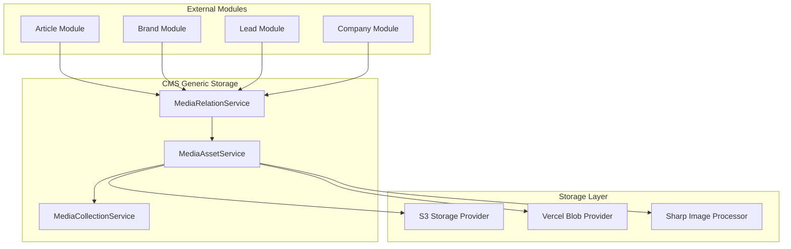
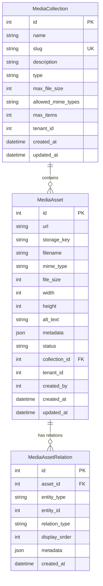

# Design Document: CMS Generic Storage

## Overview

The CMS Generic Storage system refactors the article-specific storage implementation into a reusable Media Asset Management system. This design enables any module (articles, brands, companies, users, leads, email campaigns) to manage media assets through a flexible, collection-based architecture with polymorphic relations.

### Key Design Principles

1. **Domain-Driven Design**: Pure domain layer with no framework dependencies
2. **Dependency Inversion**: Repository interfaces in domain, implementations in infrastructure
3. **Polymorphic Relations**: Generic entity attachment without code changes
4. **Collection-Based Validation**: Centralized rules enforcement per collection type
5. **Backward Compatibility**: Phased migration preserving existing functionality

### Architecture Layers

```
Domain Layer (Pure TypeScript)
├── Entities: MediaAsset, MediaCollection, MediaAssetRelation
├── Enums: ECollectionType, EAssetStatus
├── Interfaces: Repository contracts with Symbol tokens
└── Errors: Business-language exceptions

Application Layer
├── Services: MediaAssetService, MediaCollectionService, MediaRelationService
├── DTOs: Request/Response data transfer objects
└── Presenters: Response formatting

Infrastructure Layer
├── Controllers: HTTP endpoints (3 controllers)
├── Repositories: Prisma implementations
└── Providers: Reuse existing S3Storage, VercelBlobStorage, SharpImageProcessor
```

## Architecture

### System Context




### Module Integration Pattern

External modules integrate with CMS storage through a simple, consistent API:

```typescript
// Example: Attaching a brand logo
@Injectable()
export class BrandService {
  constructor(
    private readonly mediaRelationService: MediaRelationService,
  ) {}
  
  async attachLogo(brandId: number, assetId: number) {
    return this.mediaRelationService.attachAsset({
      asset_id: assetId,
      entity_type: 'brand',
      entity_id: brandId,
      relation_type: 'logo',
    });
  }
  
  async getBrandLogo(brandId: number) {
    return this.mediaRelationService.getEntityFeaturedImage('brand', brandId, 'logo');
  }
}
```


## Components and Interfaces

### Domain Layer Components

#### 1. MediaAsset Entity

```typescript
// domain/entities/media-asset.entity.ts
export class MediaAsset {
  public readonly id?: number;
  public url: string;
  public storage_key: string;
  public filename: string;
  public mime_type: string;
  public file_size: number;
  public width?: number;
  public height?: number;
  public alt_text?: string;
  public metadata?: Record<string, any>;
  public status: EAssetStatus;
  public collection_id: number;
  public tenant_id: number;
  public created_by: number;
  public created_at?: Date;
  public updated_at?: Date;

  constructor(data: ICreateMediaAsset) {
    this.url = data.url;
    this.storage_key = data.storage_key;
    this.filename = data.filename;
    this.mime_type = data.mime_type;
    this.file_size = data.file_size;
    this.width = data.width;
    this.height = data.height;
    this.alt_text = data.alt_text;
    this.metadata = data.metadata;
    this.status = data.status || EAssetStatus.processing;
    this.collection_id = data.collection_id;
    this.tenant_id = data.tenant_id;
    this.created_by = data.created_by;
  }

  markAsReady(): void {
    this.status = EAssetStatus.ready;
  }

  markAsFailed(): void {
    this.status = EAssetStatus.failed;
  }

  archive(): void {
    this.status = EAssetStatus.archived;
  }

  updateMetadata(alt_text?: string, metadata?: Record<string, any>): void {
    if (alt_text !== undefined) this.alt_text = alt_text;
    if (metadata !== undefined) this.metadata = { ...this.metadata, ...metadata };
  }
}
```


#### 2. MediaCollection Entity

```typescript
// domain/entities/media-collection.entity.ts
export class MediaCollection {
  public readonly id?: number;
  public name: string;
  public slug: string;
  public description?: string;
  public type: ECollectionType;
  public max_file_size?: number;
  public allowed_mime_types?: string[];
  public max_items?: number;
  public tenant_id: number;
  public created_at?: Date;
  public updated_at?: Date;

  constructor(data: ICreateMediaCollection) {
    this.name = data.name;
    this.slug = data.slug;
    this.description = data.description;
    this.type = data.type;
    this.max_file_size = data.max_file_size;
    this.allowed_mime_types = data.allowed_mime_types;
    this.max_items = data.max_items;
    this.tenant_id = data.tenant_id;
  }

  validateFileSize(size: number): boolean {
    if (!this.max_file_size) return true;
    return size <= this.max_file_size;
  }

  validateMimeType(mimeType: string): boolean {
    if (!this.allowed_mime_types || this.allowed_mime_types.length === 0) return true;
    
    return this.allowed_mime_types.some(allowed => {
      if (allowed === '*') return true;
      if (allowed.endsWith('/*')) {
        const prefix = allowed.slice(0, -2);
        return mimeType.startsWith(prefix + '/');
      }
      return allowed === mimeType;
    });
  }

  canAddMoreItems(currentCount: number): boolean {
    if (!this.max_items) return true;
    return currentCount < this.max_items;
  }
}
```


#### 3. MediaAssetRelation Entity

```typescript
// domain/entities/media-asset-relation.entity.ts
export class MediaAssetRelation {
  public readonly id?: number;
  public asset_id: number;
  public entity_type: string;
  public entity_id: number;
  public relation_type: string;
  public display_order?: number;
  public metadata?: Record<string, any>;
  public created_at?: Date;

  constructor(data: ICreateMediaAssetRelation) {
    this.asset_id = data.asset_id;
    this.entity_type = data.entity_type.toLowerCase();
    this.entity_id = data.entity_id;
    this.relation_type = data.relation_type.toLowerCase();
    this.display_order = data.display_order;
    this.metadata = data.metadata;
  }

  updateOrder(newOrder: number): void {
    this.display_order = newOrder;
  }
}
```

#### 4. Domain Enums

```typescript
// domain/enums/collection-type.enum.ts
export enum ECollectionType {
  image = 'image',
  document = 'document',
  video = 'video',
  audio = 'audio',
  mixed = 'mixed',
}

// domain/enums/asset-status.enum.ts
export enum EAssetStatus {
  processing = 'processing',
  ready = 'ready',
  failed = 'failed',
  archived = 'archived',
}
```


#### 5. Domain Errors

```typescript
// domain/errors/asset-not-found.error.ts
export class AssetNotFoundError extends Error {
  constructor(assetId: number) {
    super(`Media asset with ID ${assetId} not found`);
    this.name = 'AssetNotFoundError';
  }
}

// domain/errors/collection-not-found.error.ts
export class CollectionNotFoundError extends Error {
  constructor(identifier: string | number) {
    super(`Media collection ${identifier} not found`);
    this.name = 'CollectionNotFoundError';
  }
}

// domain/errors/collection-limit-exceeded.error.ts
export class CollectionLimitExceededError extends Error {
  constructor(collectionName: string, limit: number) {
    super(`Collection '${collectionName}' has reached its maximum limit of ${limit} items`);
    this.name = 'CollectionLimitExceededError';
  }
}

// domain/errors/invalid-file-type.error.ts
export class InvalidFileTypeError extends Error {
  constructor(mimeType: string, allowedTypes: string[]) {
    super(`File type '${mimeType}' is not allowed. Allowed types: ${allowedTypes.join(', ')}`);
    this.name = 'InvalidFileTypeError';
  }
}

// domain/errors/file-size-exceeded.error.ts
export class FileSizeExceededError extends Error {
  constructor(size: number, maxSize: number) {
    super(`File size ${size} bytes exceeds maximum allowed size of ${maxSize} bytes`);
    this.name = 'FileSizeExceededError';
  }
}
```


#### 6. Repository Interfaces

```typescript
// domain/interfaces/media-asset.repository.interface.ts
export const MEDIA_ASSET_REPOSITORY = Symbol('MEDIA_ASSET_REPOSITORY');

export interface IMediaAssetRepository {
  create(entity: MediaAsset): Promise<MediaAsset>;
  findById(id: number, tenantId: number): Promise<MediaAsset | null>;
  findAll(params: IFindAssetsParams): Promise<IPaginatedResult<MediaAsset>>;
  update(id: number, data: Partial<MediaAsset>, tenantId: number): Promise<MediaAsset>;
  delete(id: number, tenantId: number): Promise<void>;
  countByCollection(collectionId: number, tenantId: number): Promise<number>;
}

export interface IFindAssetsParams {
  tenant_id: number;
  collection_id?: number;
  status?: EAssetStatus;
  mime_type?: string;
  page?: number;
  limit?: number;
}

// domain/interfaces/media-collection.repository.interface.ts
export const MEDIA_COLLECTION_REPOSITORY = Symbol('MEDIA_COLLECTION_REPOSITORY');

export interface IMediaCollectionRepository {
  create(entity: MediaCollection): Promise<MediaCollection>;
  findById(id: number, tenantId: number): Promise<MediaCollection | null>;
  findBySlug(slug: string, tenantId: number): Promise<MediaCollection | null>;
  findAll(params: IFindCollectionsParams): Promise<IPaginatedResult<MediaCollection>>;
  update(id: number, data: Partial<MediaCollection>, tenantId: number): Promise<MediaCollection>;
  delete(id: number, tenantId: number): Promise<void>;
}

export interface IFindCollectionsParams {
  tenant_id: number;
  type?: ECollectionType;
  page?: number;
  limit?: number;
}

// domain/interfaces/media-relation.repository.interface.ts
export const MEDIA_RELATION_REPOSITORY = Symbol('MEDIA_RELATION_REPOSITORY');

export interface IMediaRelationRepository {
  create(entity: MediaAssetRelation): Promise<MediaAssetRelation>;
  findByEntity(entityType: string, entityId: number, relationType?: string): Promise<MediaAssetRelation[]>;
  findByAsset(assetId: number): Promise<MediaAssetRelation[]>;
  delete(assetId: number, entityType: string, entityId: number, relationType: string): Promise<void>;
  deleteByAsset(assetId: number): Promise<void>;
  updateOrder(relations: Array<{ id: number; display_order: number }>): Promise<void>;
  exists(assetId: number, entityType: string, entityId: number, relationType: string): Promise<boolean>;
}
```


### Application Layer Components

#### 1. MediaAssetService

```typescript
// application/services/media-asset.service.ts
@Injectable()
export class MediaAssetService {
  constructor(
    @Inject(MEDIA_ASSET_REPOSITORY)
    private readonly assetRepo: IMediaAssetRepository,
    @Inject(MEDIA_COLLECTION_REPOSITORY)
    private readonly collectionRepo: IMediaCollectionRepository,
    @Inject(STORAGE_PROVIDER)
    private readonly storageProvider: IStorageProvider,
    @Inject(IMAGE_PROCESSOR)
    private readonly imageProcessor: IImageProcessor,
  ) {}

  async uploadAsset(
    file: Express.Multer.File,
    dto: UploadMediaDTO,
    tenantId: number,
    userId: number,
  ): Promise<ServiceResponse<MediaAsset>> {
    // 1. Validate collection exists
    const collection = await this.collectionRepo.findById(dto.collection_id, tenantId);
    if (!collection) {
      return errorResponse(ERROR_COLLECTION_NOT_FOUND, 404);
    }

    // 2. Validate file size
    if (!collection.validateFileSize(file.size)) {
      return errorResponse(ERROR_FILE_SIZE_EXCEEDED, 422);
    }

    // 3. Validate mime type
    if (!collection.validateMimeType(file.mimetype)) {
      return errorResponse(ERROR_INVALID_FILE_TYPE, 422);
    }

    // 4. Check collection item limit
    const currentCount = await this.assetRepo.countByCollection(dto.collection_id, tenantId);
    if (!collection.canAddMoreItems(currentCount)) {
      return errorResponse(ERROR_COLLECTION_LIMIT_EXCEEDED, 400);
    }

    // 5. Process image if applicable
    let processedBuffer = file.buffer;
    let width: number | undefined;
    let height: number | undefined;
    let finalMimeType = file.mimetype;

    if (file.mimetype.startsWith('image/')) {
      const quality = parseInt(process.env.CMS_IMAGE_QUALITY || '80', 10);
      const processed = await this.imageProcessor.processToWebp(file.buffer, quality);
      processedBuffer = processed.data;
      finalMimeType = 'image/webp';
      
      // Extract dimensions using sharp
      const metadata = await sharp(file.buffer).metadata();
      width = metadata.width;
      height = metadata.height;
    }

    // 6. Generate storage key
    const timestamp = Date.now();
    const sanitizedFilename = this.sanitizeFilename(file.originalname);
    const storageKey = `cms/${tenantId}/${collection.slug}/${timestamp}-${sanitizedFilename}`;

    // 7. Upload to storage
    const uploadResult = await this.storageProvider.upload(
      storageKey,
      processedBuffer,
      finalMimeType,
    );

    // 8. Create asset entity
    const asset = new MediaAsset({
      url: uploadResult.url,
      storage_key: uploadResult.key,
      filename: file.originalname,
      mime_type: finalMimeType,
      file_size: processedBuffer.length,
      width,
      height,
      alt_text: dto.alt_text,
      metadata: dto.metadata,
      status: EAssetStatus.ready,
      collection_id: dto.collection_id,
      tenant_id: tenantId,
      created_by: userId,
    });

    const saved = await this.assetRepo.create(asset);
    return successResponse(saved, 201);
  }

  async deleteAsset(id: number, tenantId: number): Promise<ServiceResponse> {
    const asset = await this.assetRepo.findById(id, tenantId);
    if (!asset) {
      return errorResponse(ERROR_ASSET_NOT_FOUND, 404);
    }

    // Delete from storage
    await this.storageProvider.delete(asset.storage_key);

    // Delete from database (cascade deletes relations)
    await this.assetRepo.delete(id, tenantId);

    return successResponse({ deleted: true }, 200);
  }

  private sanitizeFilename(filename: string): string {
    return filename
      .replace(/[^a-zA-Z0-9.-]/g, '_')
      .replace(/_{2,}/g, '_')
      .toLowerCase();
  }
}
```


#### 2. MediaCollectionService

```typescript
// application/services/media-collection.service.ts
@Injectable()
export class MediaCollectionService {
  constructor(
    @Inject(MEDIA_COLLECTION_REPOSITORY)
    private readonly collectionRepo: IMediaCollectionRepository,
  ) {}

  async createCollection(
    dto: CreateCollectionDTO,
    tenantId: number,
  ): Promise<ServiceResponse<MediaCollection>> {
    // Check if slug already exists for tenant
    const existing = await this.collectionRepo.findBySlug(dto.slug, tenantId);
    if (existing) {
      return errorResponse(ERROR_COLLECTION_SLUG_EXISTS, 409);
    }

    const collection = new MediaCollection({
      name: dto.name,
      slug: dto.slug,
      description: dto.description,
      type: dto.type,
      max_file_size: dto.max_file_size,
      allowed_mime_types: dto.allowed_mime_types,
      max_items: dto.max_items,
      tenant_id: tenantId,
    });

    const saved = await this.collectionRepo.create(collection);
    return successResponse(saved, 201);
  }

  async getCollectionAssets(
    id: number,
    tenantId: number,
    page: number = 1,
    limit: number = 20,
  ): Promise<ServiceResponse<IPaginatedResult<MediaAsset>>> {
    const collection = await this.collectionRepo.findById(id, tenantId);
    if (!collection) {
      return errorResponse(ERROR_COLLECTION_NOT_FOUND, 404);
    }

    const assets = await this.assetRepo.findAll({
      tenant_id: tenantId,
      collection_id: id,
      page,
      limit,
    });

    return successResponse(assets, 200);
  }
}
```


#### 3. MediaRelationService

```typescript
// application/services/media-relation.service.ts
@Injectable()
export class MediaRelationService {
  constructor(
    @Inject(MEDIA_RELATION_REPOSITORY)
    private readonly relationRepo: IMediaRelationRepository,
    @Inject(MEDIA_ASSET_REPOSITORY)
    private readonly assetRepo: IMediaAssetRepository,
  ) {}

  async attachAsset(dto: AttachMediaDTO, tenantId: number): Promise<ServiceResponse<MediaAssetRelation>> {
    // Validate asset exists and belongs to tenant
    const asset = await this.assetRepo.findById(dto.asset_id, tenantId);
    if (!asset) {
      return errorResponse(ERROR_ASSET_NOT_FOUND, 404);
    }

    // Check if relation already exists
    const exists = await this.relationRepo.exists(
      dto.asset_id,
      dto.entity_type,
      dto.entity_id,
      dto.relation_type,
    );
    if (exists) {
      return errorResponse(ERROR_RELATION_ALREADY_EXISTS, 409);
    }

    // Get current max display_order for this entity
    const existingRelations = await this.relationRepo.findByEntity(
      dto.entity_type,
      dto.entity_id,
      dto.relation_type,
    );
    const maxOrder = existingRelations.reduce((max, rel) => 
      Math.max(max, rel.display_order || 0), 0
    );

    const relation = new MediaAssetRelation({
      asset_id: dto.asset_id,
      entity_type: dto.entity_type,
      entity_id: dto.entity_id,
      relation_type: dto.relation_type,
      display_order: dto.display_order ?? maxOrder + 1,
      metadata: dto.metadata,
    });

    const saved = await this.relationRepo.create(relation);
    return successResponse(saved, 201);
  }

  async detachAsset(dto: DetachMediaDTO): Promise<ServiceResponse> {
    await this.relationRepo.delete(
      dto.asset_id,
      dto.entity_type,
      dto.entity_id,
      dto.relation_type,
    );
    return successResponse({ detached: true }, 200);
  }

  async getEntityAssets(
    entityType: string,
    entityId: number,
    relationType?: string,
  ): Promise<ServiceResponse<MediaAsset[]>> {
    const relations = await this.relationRepo.findByEntity(entityType, entityId, relationType);
    
    // Fetch full asset details
    const assetIds = relations.map(r => r.asset_id);
    const assets = await Promise.all(
      assetIds.map(id => this.assetRepo.findById(id, relations[0]?.tenant_id || 0))
    );

    // Sort by display_order
    const sortedAssets = assets
      .filter(a => a !== null)
      .sort((a, b) => {
        const relA = relations.find(r => r.asset_id === a!.id);
        const relB = relations.find(r => r.asset_id === b!.id);
        return (relA?.display_order || 0) - (relB?.display_order || 0);
      });

    return successResponse(sortedAssets as MediaAsset[], 200);
  }

  async getEntityFeaturedImage(
    entityType: string,
    entityId: number,
    relationType: string = 'featured',
  ): Promise<ServiceResponse<MediaAsset | null>> {
    const result = await this.getEntityAssets(entityType, entityId, relationType);
    if (result.status !== 200) return result;
    
    const assets = result.data as MediaAsset[];
    return successResponse(assets[0] || null, 200);
  }

  async reorderAssets(dto: ReorderMediaDTO): Promise<ServiceResponse> {
    const updates = dto.items.map((item, index) => ({
      id: item.relation_id,
      display_order: index + 1,
    }));

    await this.relationRepo.updateOrder(updates);
    return successResponse({ reordered: true }, 200);
  }
}
```


## Data Models

### Database Schema

The system uses three main tables with the following relationships:



### Prisma Schema (Already Defined)

The schema is already defined in `prisma/schema.prisma`:

```prisma
model MediaCollection {
  id                  Int           @id @default(autoincrement())
  name                String        @db.VarChar(100)
  slug                String        @db.VarChar(100)
  description         String?       @db.Text
  type                String        @db.VarChar(20)
  max_file_size       Int?
  allowed_mime_types  String?       @db.Text
  max_items           Int?
  tenant_id           Int
  created_at          DateTime      @default(now())
  updated_at          DateTime      @updatedAt
  
  assets              MediaAsset[]
  
  @@unique([tenant_id, slug])
  @@index([tenant_id])
  @@map("media_collections")
}

model MediaAsset {
  id              Int                   @id @default(autoincrement())
  url             String                @db.VarChar(500)
  storage_key     String                @db.VarChar(500)
  filename        String                @db.VarChar(255)
  mime_type       String                @db.VarChar(100)
  file_size       Int
  width           Int?
  height          Int?
  alt_text        String?               @db.VarChar(255)
  metadata        Json?
  status          String                @default("ready") @db.VarChar(20)
  collection_id   Int
  tenant_id       Int
  created_by      Int
  created_at      DateTime              @default(now())
  updated_at      DateTime              @updatedAt
  
  collection      MediaCollection       @relation(fields: [collection_id], references: [id], onDelete: Cascade)
  relations       MediaAssetRelation[]
  
  @@index([collection_id])
  @@index([tenant_id])
  @@index([created_by])
  @@index([status])
  @@map("media_assets")
}

model MediaAssetRelation {
  id              Int         @id @default(autoincrement())
  asset_id        Int
  entity_type     String      @db.VarChar(50)
  entity_id       Int
  relation_type   String      @db.VarChar(50)
  display_order   Int?
  metadata        Json?
  created_at      DateTime    @default(now())
  
  asset           MediaAsset  @relation(fields: [asset_id], references: [id], onDelete: Cascade)
  
  @@unique([asset_id, entity_type, entity_id, relation_type])
  @@index([entity_type, entity_id])
  @@index([asset_id])
  @@map("media_asset_relations")
}
```

### Key Design Decisions

1. **Polymorphic Relations**: `entity_type` and `entity_id` allow any entity to attach assets without schema changes
2. **Tenant Isolation**: All queries filtered by `tenant_id` for multi-tenancy
3. **Cascade Deletion**: When asset is deleted, all relations are automatically removed
4. **Flexible Metadata**: JSON fields allow extension without schema migrations
5. **Display Order**: Nullable integer for sorting, automatically assigned if not provided
6. **Status Tracking**: Enables async processing workflows (processing → ready/failed)


## Correctness Properties

A property is a characteristic or behavior that should hold true across all valid executions of a system—essentially, a formal statement about what the system should do. Properties serve as the bridge between human-readable specifications and machine-verifiable correctness guarantees.

### Property 1: Asset Creation Completeness

*For any* valid file upload with collection_id, tenant_id, and user_id, the created MediaAsset should have all required fields populated (url, storage_key, filename, mime_type, file_size, status, collection_id, tenant_id, created_by) and optional fields (width, height for images, alt_text, metadata) should match the input.

**Validates: Requirements 1.1, 1.2, 1.3, 1.4, 1.5**

### Property 2: Storage and Database Consistency

*For any* MediaAsset, if it exists in the database, then its storage_key should reference a file in the StorageProvider, and if the asset is deleted, both the database record and storage file should be removed.

**Validates: Requirements 1.6**

### Property 3: Asset Query Filtering

*For any* set of MediaAssets and filter criteria (collection_id, status, mime_type), querying with those filters should return only assets matching all specified criteria.

**Validates: Requirements 1.7**

### Property 4: Asset Update Constraints

*For any* MediaAsset update operation, only the alt_text and metadata fields should be modifiable; attempting to change other fields (url, storage_key, filename, mime_type, file_size, collection_id, tenant_id) should either be ignored or rejected.

**Validates: Requirements 1.8**

### Property 5: Collection Slug Uniqueness Per Tenant

*For any* tenant_id and slug combination, only one MediaCollection should exist; attempting to create a second collection with the same tenant_id and slug should be rejected.

**Validates: Requirements 2.1**

### Property 6: Collection Validation Rules Enforcement

*For any* MediaCollection with defined rules (max_file_size, allowed_mime_types, max_items) and any file upload attempt, the upload should be rejected if it violates any of the collection's rules, and accepted only if it satisfies all rules.

**Validates: Requirements 2.3, 2.4, 2.5, 4.2, 4.3, 4.4**

### Property 7: Mime Type Wildcard Matching

*For any* MediaCollection with allowed_mime_types containing wildcard patterns (e.g., 'image/*', '*'), a file's mime_type should match if it satisfies the wildcard pattern (e.g., 'image/jpeg' matches 'image/*').

**Validates: Requirements 2.6**

### Property 8: Collection Referential Integrity

*For any* MediaCollection that contains one or more MediaAssets, attempting to delete the collection should be rejected; only empty collections should be deletable.

**Validates: Requirements 2.8**

### Property 9: Relation Creation Correctness

*For any* valid asset attachment (asset_id, entity_type, entity_id, relation_type), the created MediaAssetRelation should have entity_type and relation_type converted to lowercase, and display_order should be assigned (either from input or auto-incremented from existing relations).

**Validates: Requirements 3.1, 3.3, 3.4**

### Property 10: Relation Uniqueness Constraint

*For any* combination of (asset_id, entity_type, entity_id, relation_type), only one MediaAssetRelation should exist; attempting to create a duplicate should be rejected.

**Validates: Requirements 3.2**

### Property 11: Relation Cascade Deletion

*For any* MediaAsset with one or more MediaAssetRelations, when the asset is deleted, all its relations should also be deleted automatically.

**Validates: Requirements 3.6**

### Property 12: Entity Asset Query Filtering

*For any* entity (entity_type, entity_id) and optional relation_type filter, querying entity assets should return only assets attached to that entity, filtered by relation_type if specified, and sorted by display_order.

**Validates: Requirements 3.7**

### Property 13: Asset Reordering Atomicity

*For any* set of MediaAssetRelations for an entity and a new ordering, updating the display_order values should result in all relations having their display_order updated to match the new sequence without gaps or duplicates.

**Validates: Requirements 3.8**

### Property 14: Polymorphic Extensibility

*For any* arbitrary string values used as entity_type or relation_type (not predefined in code), the system should accept and store them correctly, enabling attachment of assets to any entity without code changes.

**Validates: Requirements 3.9, 3.10**

### Property 15: Tenant Isolation

*For any* MediaAsset, MediaCollection, or MediaAssetRelation operation, the system should enforce tenant_id filtering such that users can only access resources belonging to their tenant, and attempting to access another tenant's resources should be rejected.

**Validates: Requirements 4.1, 15.1, 15.2, 15.7**

### Property 16: Image Format Conversion

*For any* uploaded file with mime_type starting with 'image/', the system should process it through ImageProcessor, convert it to WebP format, and store the result with mime_type 'image/webp'.

**Validates: Requirements 4.5**

### Property 17: Validation Failure Atomicity

*For any* file upload that fails validation (collection not found, file too large, invalid mime type, item limit exceeded), the system should return an error without creating any database records or storage files.

**Validates: Requirements 4.7**

### Property 18: Seed Idempotence

*For any* number of times the system collection seed script is executed, the result should be the same set of system collections (article-images, article-featured, brand-logos, company-documents, user-avatars, email-attachments) with no duplicates or errors.

**Validates: Requirements 5.7**


## Error Handling

### Error Constants

```typescript
// Error constants for reserve-cms (media management)
export const ERROR_ASSET_NOT_FOUND = '404:Media asset not found';
export const ERROR_COLLECTION_NOT_FOUND = '404:Media collection not found';
export const ERROR_COLLECTION_SLUG_EXISTS = '409:Collection slug already exists for this tenant';
export const ERROR_COLLECTION_LIMIT_EXCEEDED = '400:Collection has reached its maximum item limit';
export const ERROR_INVALID_FILE_TYPE = '422:File type not allowed for this collection';
export const ERROR_FILE_SIZE_EXCEEDED = '422:File size exceeds collection maximum';
export const ERROR_RELATION_ALREADY_EXISTS = '409:Asset is already attached to this entity with this relation type';
export const ERROR_STORAGE_PROVIDER_ERROR = '500:Storage provider operation failed';
export const ERROR_IMAGE_PROCESSING_FAILED = '500:Image processing failed';
export const ERROR_COLLECTION_NOT_EMPTY = '400:Cannot delete collection that contains assets';
```

### Exception Flow

```
Domain Layer Errors (Pure TypeScript)
├── AssetNotFoundError
├── CollectionNotFoundError
├── CollectionLimitExceededError
├── InvalidFileTypeError
└── FileSizeExceededError
         ↓
Application Layer (ServiceResponse)
├── Catches domain errors
├── Wraps in ServiceResponse { status, data }
└── Returns error constants
         ↓
Infrastructure Layer (HTTP)
├── Translates ServiceResponse to HTTP status
├── Returns JSON error response
└── Logs errors for monitoring
```

### Error Handling Pattern

```typescript
// Application Service
async uploadAsset(...): Promise<ServiceResponse<MediaAsset>> {
  try {
    // Business logic
    const collection = await this.collectionRepo.findById(dto.collection_id, tenantId);
    if (!collection) {
      return errorResponse(ERROR_COLLECTION_NOT_FOUND, 404);
    }
    
    if (!collection.validateFileSize(file.size)) {
      return errorResponse(ERROR_FILE_SIZE_EXCEEDED, 422);
    }
    
    // ... more logic
    return successResponse(saved, 201);
  } catch (err) {
    if (err instanceof DomainException) {
      return errorResponse(err.message, 400);
    }
    if (err instanceof RepositoryException) {
      return errorResponse(ERROR_STORAGE_PROVIDER_ERROR, 500, err);
    }
    throw err; // Unexpected errors bubble up
  }
}

// Controller
@Post('/')
async upload(@UploadedFile() file, @Body() dto, @Res() res) {
  const result = await this.assetService.uploadAsset(file, dto, tenantId, userId);
  return res.status(result.status).json(result.data);
}
```


## Testing Strategy

### Dual Testing Approach

The system requires both unit tests and property-based tests for comprehensive coverage:

**Unit Tests** - Specific examples, edge cases, and error conditions:
- Uploading a specific image file and verifying WebP conversion
- Attempting to delete a non-empty collection and verifying rejection
- Creating a collection with duplicate slug and verifying error
- Attaching an asset to a non-existent entity
- Seed script execution and verification of system collections

**Property-Based Tests** - Universal properties across all inputs:
- For any valid file upload, all required fields are populated (Property 1)
- For any collection with rules, validation is enforced (Property 6)
- For any asset deletion, storage and database are cleaned up (Property 2)
- For any relation creation, uniqueness is enforced (Property 10)
- For any tenant, isolation is maintained (Property 15)

### Property-Based Testing Configuration

**Library**: Use `fast-check` for TypeScript property-based testing

**Configuration**:
- Minimum 100 iterations per property test
- Each test tagged with feature name and property number
- Tag format: `Feature: cms-generic-storage, Property {N}: {property_text}`

**Example Property Test**:

```typescript
// __tests__/properties/asset-creation-completeness.spec.ts
import * as fc from 'fast-check';

describe('Feature: cms-generic-storage, Property 1: Asset Creation Completeness', () => {
  it('should populate all required fields for any valid upload', async () => {
    await fc.assert(
      fc.asyncProperty(
        fc.record({
          filename: fc.string({ minLength: 1, maxLength: 255 }),
          mime_type: fc.constantFrom('image/jpeg', 'image/png', 'application/pdf'),
          file_size: fc.integer({ min: 1, max: 10_000_000 }),
          collection_id: fc.integer({ min: 1, max: 100 }),
          tenant_id: fc.integer({ min: 1, max: 10 }),
          created_by: fc.integer({ min: 1, max: 1000 }),
        }),
        async (input) => {
          const buffer = Buffer.alloc(input.file_size);
          const file = {
            buffer,
            originalname: input.filename,
            mimetype: input.mime_type,
            size: input.file_size,
          } as Express.Multer.File;

          const result = await assetService.uploadAsset(
            file,
            { collection_id: input.collection_id },
            input.tenant_id,
            input.created_by,
          );

          if (result.status === 201) {
            const asset = result.data as MediaAsset;
            expect(asset.url).toBeDefined();
            expect(asset.storage_key).toBeDefined();
            expect(asset.filename).toBe(input.filename);
            expect(asset.file_size).toBeGreaterThan(0);
            expect(asset.status).toBe(EAssetStatus.ready);
            expect(asset.collection_id).toBe(input.collection_id);
            expect(asset.tenant_id).toBe(input.tenant_id);
            expect(asset.created_by).toBe(input.created_by);
          }
        }
      ),
      { numRuns: 100 }
    );
  });
});
```

### Test Coverage Requirements

| Layer | Unit Tests | Property Tests | Integration Tests | E2E Tests |
|-------|-----------|----------------|-------------------|-----------|
| Domain Entities | ✓ Business rules | ✓ Invariants | - | - |
| Application Services | ✓ Error handling | ✓ Properties 1-18 | - | - |
| Infrastructure Repos | - | - | ✓ Database ops | - |
| Controllers | - | - | - | ✓ Critical flows |

### Critical E2E Test Flows

1. **Upload and Attach Flow**: Upload image → Verify WebP conversion → Attach to article → Verify relation
2. **Collection Validation Flow**: Create collection with rules → Attempt invalid upload → Verify rejection
3. **Deletion Cascade Flow**: Create asset with relations → Delete asset → Verify relations removed
4. **Reorder Flow**: Attach multiple assets → Reorder → Verify new order persists
5. **Tenant Isolation Flow**: Create asset as Tenant A → Attempt access as Tenant B → Verify rejection

### In-Memory Repository Fakes

For TDD, create in-memory implementations:

```typescript
// shared/testing/in-memory-repos/in-memory-media-asset.repo.ts
export class InMemoryMediaAssetRepo implements IMediaAssetRepository {
  private assets: MediaAsset[] = [];
  private nextId = 1;

  async create(entity: MediaAsset): Promise<MediaAsset> {
    const saved = { ...entity, id: this.nextId++ };
    this.assets.push(saved);
    return saved;
  }

  async findById(id: number, tenantId: number): Promise<MediaAsset | null> {
    return this.assets.find(a => a.id === id && a.tenant_id === tenantId) || null;
  }

  // ... other methods
}
```


## Migration Strategy

### Phase 1: Create New Structure (Non-Breaking)

**Duration**: 3-4 days

**Objectives**:
- Implement complete new system alongside existing ArticleImage system
- No changes to existing code
- New tables already exist in schema

**Tasks**:
1. Create domain layer (entities, enums, interfaces, errors)
2. Create application layer (services, DTOs, presenters)
3. Create infrastructure layer (controllers, repositories)
4. Wire up ReserveCmsModule with new providers
5. Write unit tests and property tests
6. Document API endpoints in Swagger

**Validation**: New endpoints work independently, old system unchanged

### Phase 2: Data Migration

**Duration**: 1-2 days

**Objectives**:
- Migrate existing ArticleImage data to new system
- Validate data integrity
- Create system collections seed

**Tasks**:
1. Create seed script for system collections (article-images, article-featured, brand-logos, etc.)
2. Create migration script to copy ArticleImage → MediaAsset + MediaAssetRelation
3. Map ArticleImage.article_id → MediaAssetRelation(entity_type='article', entity_id=article_id)
4. Preserve display_order, alt_text, storage_key, url
5. Create validation script to verify all data migrated correctly
6. Run migration in staging environment

**Migration Script Logic**:

```typescript
// prisma/seed/migrate-article-images.ts
async function migrateArticleImages() {
  // 1. Ensure article-images collection exists
  let collection = await prisma.mediaCollection.findFirst({
    where: { slug: 'article-images', tenant_id: 1 }
  });
  
  if (!collection) {
    collection = await prisma.mediaCollection.create({
      data: {
        name: 'Article Images',
        slug: 'article-images',
        type: 'image',
        max_file_size: 10_000_000,
        allowed_mime_types: JSON.stringify(['image/*']),
        max_items: 20,
        tenant_id: 1,
      }
    });
  }

  // 2. Migrate ArticleImage records
  const articleImages = await prisma.articleImage.findMany();
  
  for (const img of articleImages) {
    // Create MediaAsset
    const asset = await prisma.mediaAsset.create({
      data: {
        url: img.url,
        storage_key: img.storage_key,
        filename: `article-${img.article_id}-${img.id}`,
        mime_type: 'image/webp',
        file_size: img.file_size,
        alt_text: img.alt_text,
        status: 'ready',
        collection_id: collection.id,
        tenant_id: 1,
        created_by: 1, // System user
      }
    });

    // Create MediaAssetRelation
    await prisma.mediaAssetRelation.create({
      data: {
        asset_id: asset.id,
        entity_type: 'article',
        entity_id: img.article_id,
        relation_type: 'gallery',
        display_order: img.display_order,
      }
    });
  }

  console.log(`Migrated ${articleImages.length} article images`);
}
```

**Validation**: All ArticleImage records have corresponding MediaAsset + MediaAssetRelation

### Phase 3: Update Article Module

**Duration**: 1-2 days

**Objectives**:
- Update ArticleService to use new MediaRelationService
- Deprecate old ArticleImageController
- Maintain backward compatibility

**Tasks**:
1. Update ArticleService to inject MediaRelationService
2. Add methods: `getArticleImages()`, `attachImageToArticle()`, `removeImageFromArticle()`
3. Mark ArticleImageController with `@deprecated` decorator
4. Update ArticleController to use new media endpoints
5. Update integration tests
6. Document migration guide for API consumers

**Example Integration**:

```typescript
// modules/reserve-cms/application/services/article.service.ts
@Injectable()
export class ArticleService {
  constructor(
    @Inject(ARTICLE_REPOSITORY)
    private readonly articleRepo: IArticleRepository,
    private readonly mediaRelationService: MediaRelationService, // NEW
  ) {}

  async getArticleImages(articleId: number): Promise<ServiceResponse<MediaAsset[]>> {
    return this.mediaRelationService.getEntityAssets('article', articleId, 'gallery');
  }

  async attachImage(articleId: number, assetId: number): Promise<ServiceResponse> {
    return this.mediaRelationService.attachAsset({
      asset_id: assetId,
      entity_type: 'article',
      entity_id: articleId,
      relation_type: 'gallery',
    }, tenantId);
  }
}
```

**Validation**: Article module works with new system, old endpoints still functional

### Phase 4: Cleanup (Breaking Change)

**Duration**: 1 day

**Objectives**:
- Remove old ArticleImage system
- Clean up deprecated code

**Tasks**:
1. Remove ArticleImage table via Prisma migration
2. Delete ArticleImageController
3. Delete ArticleImageService
4. Delete PrismaArticleImageRepository
5. Remove ArticleImage entity and interface
6. Update documentation
7. Announce breaking change to API consumers

**Breaking Changes**:
- `POST /api/cms/articles/:id/images` → `POST /api/cms/media` + `POST /api/cms/relations/attach`
- `GET /api/cms/articles/:id/images` → `GET /api/cms/relations/article/:id`
- `DELETE /api/cms/articles/:id/images/:imageId` → `DELETE /api/cms/media/:id`

**Validation**: Old endpoints removed, new system fully operational

### Rollback Plan

If issues arise during Phase 3 or 4:
1. Revert code changes to previous phase
2. Keep both systems running until issues resolved
3. Data migration is one-way (ArticleImage → MediaAsset), but old table preserved until Phase 4


## API Endpoints Summary

### Media Assets (`/api/cms/media`)

| Method | Endpoint | Description | Auth |
|--------|----------|-------------|------|
| POST | `/` | Upload asset to collection | Admin/User |
| GET | `/` | List assets (filterable) | Admin/User |
| GET | `/:id` | Get asset details | Admin/User |
| PATCH | `/:id` | Update metadata | Admin/User |
| DELETE | `/:id` | Delete asset | Admin |

### Collections (`/api/cms/collections`)

| Method | Endpoint | Description | Auth |
|--------|----------|-------------|------|
| POST | `/` | Create custom collection | Admin |
| GET | `/` | List collections | Admin/User |
| GET | `/:id` | Get collection details | Admin/User |
| GET | `/:id/assets` | List collection assets | Admin/User |
| PUT | `/:id` | Update collection | Admin |
| DELETE | `/:id` | Delete collection | Admin |

### Relations (`/api/cms/relations`)

| Method | Endpoint | Description | Auth |
|--------|----------|-------------|------|
| POST | `/attach` | Attach asset to entity | Admin/User |
| POST | `/detach` | Detach asset from entity | Admin/User |
| GET | `/:entityType/:entityId` | Get entity's assets | Admin/User |
| PUT | `/reorder` | Reorder entity assets | Admin/User |

### Request/Response Examples

**Upload Asset**:
```http
POST /api/cms/media
Content-Type: multipart/form-data

{
  "file": <binary>,
  "collection_id": 1,
  "alt_text": "Brand logo",
  "metadata": { "category": "marketing" }
}

Response 201:
{
  "id": 123,
  "url": "https://storage.example.com/cms/1/brand-logos/1234567890-logo.webp",
  "storage_key": "cms/1/brand-logos/1234567890-logo.webp",
  "filename": "logo.png",
  "mime_type": "image/webp",
  "file_size": 45678,
  "width": 512,
  "height": 512,
  "alt_text": "Brand logo",
  "status": "ready",
  "collection_id": 1,
  "tenant_id": 1,
  "created_by": 5,
  "created_at": "2024-01-15T10:30:00Z"
}
```

**Attach Asset to Entity**:
```http
POST /api/cms/relations/attach

{
  "asset_id": 123,
  "entity_type": "brand",
  "entity_id": 456,
  "relation_type": "logo"
}

Response 201:
{
  "id": 789,
  "asset_id": 123,
  "entity_type": "brand",
  "entity_id": 456,
  "relation_type": "logo",
  "display_order": 1,
  "created_at": "2024-01-15T10:31:00Z"
}
```

**Get Entity Assets**:
```http
GET /api/cms/relations/brand/456?relation_type=logo

Response 200:
[
  {
    "id": 123,
    "url": "https://storage.example.com/cms/1/brand-logos/1234567890-logo.webp",
    "filename": "logo.png",
    "mime_type": "image/webp",
    "alt_text": "Brand logo",
    "width": 512,
    "height": 512,
    "created_at": "2024-01-15T10:30:00Z"
  }
]
```

## Integration Examples

### Example 1: Brand Logo Upload

```typescript
// Brand module integration
@Injectable()
export class BrandService {
  constructor(
    private readonly mediaRelationService: MediaRelationService,
  ) {}

  async uploadBrandLogo(brandId: number, assetId: number, tenantId: number) {
    // Detach existing logo if any
    const existing = await this.mediaRelationService.getEntityAssets('brand', brandId, 'logo');
    if (existing.data.length > 0) {
      await this.mediaRelationService.detachAsset({
        asset_id: existing.data[0].id,
        entity_type: 'brand',
        entity_id: brandId,
        relation_type: 'logo',
      });
    }

    // Attach new logo
    return this.mediaRelationService.attachAsset({
      asset_id: assetId,
      entity_type: 'brand',
      entity_id: brandId,
      relation_type: 'logo',
    }, tenantId);
  }

  async getBrandLogo(brandId: number) {
    return this.mediaRelationService.getEntityFeaturedImage('brand', brandId, 'logo');
  }
}
```

### Example 2: Article Gallery

```typescript
// Article module integration
@Injectable()
export class ArticleService {
  constructor(
    private readonly mediaRelationService: MediaRelationService,
  ) {}

  async addImageToGallery(articleId: number, assetId: number, tenantId: number) {
    return this.mediaRelationService.attachAsset({
      asset_id: assetId,
      entity_type: 'article',
      entity_id: articleId,
      relation_type: 'gallery',
    }, tenantId);
  }

  async getArticleGallery(articleId: number) {
    return this.mediaRelationService.getEntityAssets('article', articleId, 'gallery');
  }

  async reorderGallery(articleId: number, orderedAssetIds: number[]) {
    const items = orderedAssetIds.map((assetId, index) => ({
      relation_id: assetId, // This would be the relation ID, not asset ID
      display_order: index + 1,
    }));

    return this.mediaRelationService.reorderAssets({ items });
  }
}
```

### Example 3: Email Campaign Attachments

```typescript
// Email campaign module integration
@Injectable()
export class EmailCampaignService {
  constructor(
    private readonly mediaRelationService: MediaRelationService,
  ) {}

  async attachDocument(campaignId: number, assetId: number, tenantId: number) {
    return this.mediaRelationService.attachAsset({
      asset_id: assetId,
      entity_type: 'email_campaign',
      entity_id: campaignId,
      relation_type: 'attachment',
    }, tenantId);
  }

  async getCampaignAttachments(campaignId: number) {
    return this.mediaRelationService.getEntityAssets('email_campaign', campaignId, 'attachment');
  }
}
```

## Performance Considerations

### Database Indexes

The schema includes strategic indexes for optimal query performance:

```sql
-- MediaAsset indexes
CREATE INDEX idx_media_assets_collection ON media_assets(collection_id);
CREATE INDEX idx_media_assets_tenant ON media_assets(tenant_id);
CREATE INDEX idx_media_assets_status ON media_assets(status);
CREATE INDEX idx_media_assets_created_by ON media_assets(created_by);

-- MediaAssetRelation indexes
CREATE INDEX idx_media_relations_entity ON media_asset_relations(entity_type, entity_id);
CREATE INDEX idx_media_relations_asset ON media_asset_relations(asset_id);

-- MediaCollection indexes
CREATE INDEX idx_media_collections_tenant ON media_collections(tenant_id);
CREATE UNIQUE INDEX idx_media_collections_tenant_slug ON media_collections(tenant_id, slug);
```

### Query Optimization

1. **Pagination**: All list endpoints support pagination (default: 20 items per page)
2. **Eager Loading**: Relations are loaded with assets in single query when needed
3. **Selective Fields**: Presenters return only necessary fields to reduce payload size
4. **Caching**: Collection validation rules can be cached in memory (future enhancement)

### Storage Optimization

1. **Image Compression**: All images converted to WebP with configurable quality (default: 80)
2. **Lazy Deletion**: Assets marked as 'archived' before physical deletion (future enhancement)
3. **CDN Integration**: Storage URLs can be proxied through CDN (configuration-based)

## Security Considerations

### Authentication & Authorization

1. **JWT Guards**: All endpoints protected by AdminJwtGuard or UserJwtGuard
2. **Tenant Isolation**: All queries filtered by tenant_id from JWT token
3. **Role-Based Access**: Admin-only operations (delete, create collections) enforced by guards

### File Upload Security

1. **Filename Sanitization**: Remove special characters, prevent path traversal
2. **Mime Type Validation**: Verify file content matches declared mime type
3. **Size Limits**: Enforce collection-level and global size limits
4. **Virus Scanning**: Integration point for antivirus scanning (future enhancement)

### Storage Security

1. **Unique Keys**: Generate collision-resistant storage keys using timestamp + sanitized filename
2. **Access Control**: Storage provider configured with appropriate IAM policies
3. **HTTPS Only**: All storage URLs use HTTPS protocol
4. **Signed URLs**: Support for time-limited signed URLs (future enhancement)

## Monitoring & Observability

### Logging

```typescript
// Log upload operations
logger.info('Media asset uploaded', {
  asset_id: asset.id,
  collection_id: asset.collection_id,
  tenant_id: asset.tenant_id,
  file_size: asset.file_size,
  mime_type: asset.mime_type,
});

// Log errors
logger.error('Storage provider error', {
  operation: 'upload',
  storage_key: key,
  error: err.message,
});
```

### Metrics

Track key metrics for monitoring:
- Upload success/failure rate
- Average upload time
- Storage usage per tenant
- Collection item counts
- Image processing time

### Alerts

Configure alerts for:
- High upload failure rate (> 5%)
- Storage provider errors
- Slow image processing (> 5 seconds)
- Approaching collection limits (> 90% of max_items)

## Future Enhancements

### Phase 5+ (Post-MVP)

1. **Bulk Operations**: Upload multiple files in single request
2. **Image Transformations**: On-the-fly resizing, cropping, format conversion
3. **Video Processing**: Thumbnail generation, format conversion
4. **CDN Integration**: Automatic CDN invalidation on asset updates
5. **Asset Versioning**: Keep history of asset changes
6. **Advanced Search**: Full-text search on metadata, tags
7. **Asset Sharing**: Generate public share links with expiration
8. **Usage Analytics**: Track asset views, downloads
9. **Duplicate Detection**: Prevent uploading identical files
10. **Batch Migration Tools**: CLI tools for bulk data migration

