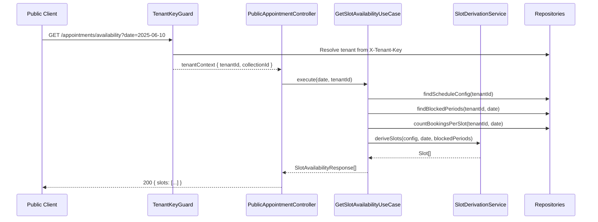
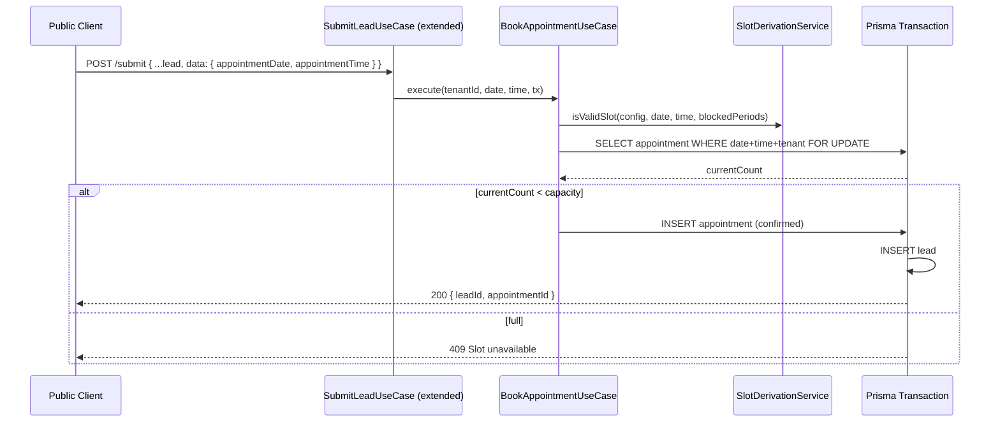

# Design Document: Leads Appointments

## Overview

This document describes the technical design for the Appointments sub-domain within the `reserve-leads` bounded context. The feature introduces first-class appointment scheduling: tenants configure their working hours and slot rules, public clients query available slots and book atomically alongside lead submission, and admins manage the full appointment lifecycle.

The implementation follows the existing DDD patterns in `reserve-leads` exactly — pure domain layer, application use cases, Prisma infrastructure repositories, and NestJS controllers with the same guard/decorator conventions already in use.

### Key Design Decisions

- **Slot derivation is a pure domain service**: `SlotDerivationService` takes a `ScheduleConfig` + date + blocked periods and returns a list of `Slot` value objects. No I/O, fully testable.
- **`selectedProduct` is a free string field** on `Appointment` — no separate product catalog.
- **Atomic booking uses a Prisma transaction** with a `SELECT ... FOR UPDATE` equivalent via `findFirst` + `update` inside `prisma.$transaction`. The spec stays implementation-agnostic; the repository encapsulates the locking strategy.
- **One `ScheduleConfig` per tenant** — upsert semantics (create if absent, replace if present).
- **Working days** are stored as an integer array (0 = Sunday … 6 = Saturday) on `AppointmentScheduleConfig`.

---

## Architecture

The appointments sub-domain lives entirely inside `src/modules/reserve-leads/` as a new set of domain entities, use cases, repositories, and controllers. No new NestJS module is created — everything is registered in the existing `ReserveLeadsModule`.

```
reserve-leads/
├── domain/
│   ├── entities/
│   │   ├── appointment-schedule-config.entity.ts   (new)
│   │   ├── appointment-blocked-period.entity.ts    (new)
│   │   └── appointment.entity.ts                   (new)
│   ├── value-objects/
│   │   └── time-slot.vo.ts                         (new)
│   ├── services/
│   │   └── slot-derivation.service.ts              (new — pure domain service)
│   ├── interfaces/
│   │   ├── appointment-schedule-config.repository.interface.ts  (new)
│   │   ├── appointment-blocked-period.repository.interface.ts   (new)
│   │   └── appointment.repository.interface.ts                  (new)
│   └── errors/
│       ├── slot-unavailable.error.ts               (new)
│       ├── slot-invalid.error.ts                   (new)
│       ├── appointment-already-cancelled.error.ts  (new)
│       └── schedule-config-not-found.error.ts      (new)
│
├── application/
│   ├── use-cases/
│   │   ├── upsert-schedule-config.use-case.ts      (new)
│   │   ├── get-schedule-config.use-case.ts         (new)
│   │   ├── get-slot-availability.use-case.ts       (new)
│   │   ├── book-appointment.use-case.ts            (new — atomic)
│   │   ├── list-appointments.use-case.ts           (new)
│   │   ├── get-appointment.use-case.ts             (new)
│   │   ├── cancel-appointment.use-case.ts          (new)
│   │   ├── complete-appointment.use-case.ts        (new)
│   │   ├── create-blocked-period.use-case.ts       (new)
│   │   ├── list-blocked-periods.use-case.ts        (new)
│   │   └── delete-blocked-period.use-case.ts       (new)
│   └── dtos/
│       ├── upsert-schedule-config.dto.ts           (new)
│       ├── get-slot-availability-query.dto.ts      (new)
│       ├── create-blocked-period.dto.ts            (new)
│       └── list-appointments-query.dto.ts          (new)
│
└── infrastructure/
    ├── repositories/
    │   ├── prisma-appointment-schedule-config.repository.ts  (new)
    │   ├── prisma-appointment-blocked-period.repository.ts   (new)
    │   └── prisma-appointment.repository.ts                  (new)
    └── controllers/
        ├── admin-appointment-schedule-config.controller.ts   (new)
        ├── admin-appointment.controller.ts                   (new)
        ├── admin-blocked-period.controller.ts                (new)
        └── public-appointment.controller.ts                  (new)
```

### Mermaid: Request Flow — Public Slot Availability



### Mermaid: Atomic Booking Flow



---

## Components and Interfaces

### Domain Interfaces

```typescript
// domain/interfaces/appointment-schedule-config.repository.interface.ts
export const APPOINTMENT_SCHEDULE_CONFIG_REPOSITORY =
  Symbol('APPOINTMENT_SCHEDULE_CONFIG_REPOSITORY');

export interface IAppointmentScheduleConfigRepository {
  upsert(config: AppointmentScheduleConfig): Promise<AppointmentScheduleConfig>;
  findByTenantId(tenantId: string): Promise<AppointmentScheduleConfig | null>;
}

// domain/interfaces/appointment-blocked-period.repository.interface.ts
export const APPOINTMENT_BLOCKED_PERIOD_REPOSITORY =
  Symbol('APPOINTMENT_BLOCKED_PERIOD_REPOSITORY');

export interface IAppointmentBlockedPeriodRepository {
  create(period: AppointmentBlockedPeriod): Promise<AppointmentBlockedPeriod>;
  findById(id: string, tenantId: string): Promise<AppointmentBlockedPeriod | null>;
  findActiveByTenantIdAndDate(tenantId: string, date: Date): Promise<AppointmentBlockedPeriod[]>;
  findAllByTenantId(tenantId: string, params: PaginationParams): Promise<PaginatedResult<AppointmentBlockedPeriod>>;
  delete(id: string): Promise<void>;
}

// domain/interfaces/appointment.repository.interface.ts
export const APPOINTMENT_REPOSITORY = Symbol('APPOINTMENT_REPOSITORY');

export interface IAppointmentRepository {
  create(appointment: Appointment, tx?: PrismaTransactionClient): Promise<Appointment>;
  findById(id: string, tenantId: string): Promise<Appointment | null>;
  findAllByTenantId(tenantId: string, params: PaginationParams): Promise<PaginatedResult<Appointment>>;
  countBySlot(tenantId: string, date: Date, slotStart: string): Promise<number>;
  updateStatus(id: string, status: EAppointmentStatus, tx?: PrismaTransactionClient): Promise<Appointment>;
  // Used for atomic booking — acquires row-level lock inside transaction
  lockAndCountBySlot(tenantId: string, date: Date, slotStart: string, tx: PrismaTransactionClient): Promise<number>;
}
```

### Domain Service Interface

```typescript
// domain/services/slot-derivation.service.ts
export class SlotDerivationService {
  deriveSlots(
    config: AppointmentScheduleConfig,
    date: Date,
    blockedPeriods: AppointmentBlockedPeriod[],
    now?: Date,  // injectable for testability; defaults to new Date()
  ): TimeSlot[];
}
```

`deriveSlots` is a **pure function** — no I/O, no side effects. It:
1. Returns `[]` if `date` is before today (comparing calendar dates only).
2. Returns `[]` if `date`'s weekday is not in `config.workingDays`.
3. Generates all slots from `work_start_time` to `work_end_time` at `slot_interval_minutes` intervals.
4. Removes slots that overlap with the lunch window (if configured).
5. Removes slots that overlap with any blocked period.
6. For today's date, removes slots whose start time has already passed (comparing against `now`).

---

## Data Models

### Prisma Schema Additions

```prisma
model AppointmentScheduleConfig {
  id                   String   @id @default(uuid()) @db.Uuid
  tenant_id            String   @db.VarChar(25)
  working_days         Int[]                          // 0=Sun … 6=Sat
  work_start_time      String   @db.VarChar(5)        // "HH:MM"
  work_end_time        String   @db.VarChar(5)        // "HH:MM"
  slot_interval_minutes Int     @db.SmallInt
  capacity_per_slot    Int      @db.SmallInt
  lunch_start_time     String?  @db.VarChar(5)        // "HH:MM" nullable
  lunch_end_time       String?  @db.VarChar(5)        // "HH:MM" nullable
  created_at           DateTime @default(now())
  updated_at           DateTime @updatedAt
  Tenant               Tenant   @relation(fields: [tenant_id], references: [id])
  Appointments         Appointment[]
  BlockedPeriods       AppointmentBlockedPeriod[]

  @@unique([tenant_id])
  @@index([tenant_id])
  @@map("AppointmentScheduleConfig")
}

model AppointmentBlockedPeriod {
  id                   String   @id @default(uuid()) @db.Uuid
  tenant_id            String   @db.VarChar(25)
  schedule_config_id   String   @db.Uuid
  start_datetime       DateTime
  end_datetime         DateTime
  label                String?  @db.VarChar(255)
  created_at           DateTime @default(now())
  updated_at           DateTime @updatedAt
  Tenant               Tenant   @relation(fields: [tenant_id], references: [id])
  ScheduleConfig       AppointmentScheduleConfig @relation(fields: [schedule_config_id], references: [id])

  @@index([tenant_id])
  @@index([tenant_id, start_datetime, end_datetime])
  @@map("AppointmentBlockedPeriod")
}

enum EAppointmentStatus {
  confirmed
  cancelled
  completed
}

model Appointment {
  id                   String              @id @default(uuid()) @db.Uuid
  tenant_id            String              @db.VarChar(25)
  lead_id              String              @db.Uuid
  schedule_config_id   String              @db.Uuid
  appointment_date     DateTime            @db.Date
  slot_start_time      String              @db.VarChar(5)   // "HH:MM"
  slot_end_time        String              @db.VarChar(5)   // "HH:MM"
  status               EAppointmentStatus  @default(confirmed)
  selected_product     String?             @db.VarChar(255)
  notes                String?             @db.Text
  created_at           DateTime            @default(now())
  updated_at           DateTime            @updatedAt
  Tenant               Tenant              @relation(fields: [tenant_id], references: [id])
  Lead                 Lead                @relation(fields: [lead_id], references: [id])
  ScheduleConfig       AppointmentScheduleConfig @relation(fields: [schedule_config_id], references: [id])

  @@index([tenant_id])
  @@index([tenant_id, appointment_date, slot_start_time])
  @@map("Appointment")
}
```

### Domain Entities

**`AppointmentScheduleConfig`** — holds all scheduling rules for a tenant. Immutable value semantics; replaced entirely on update (upsert).

**`AppointmentBlockedPeriod`** — a datetime range during which no slots are available. Has an optional human-readable label.

**`Appointment`** — a confirmed booking linking a `Lead` to a specific slot on a specific date. Carries a status lifecycle: `confirmed → cancelled | completed`.

**`TimeSlot`** (value object) — an immutable pair of `{ startTime: string, endTime: string, date: Date }` representing a derived slot. Also carries `availableCapacity` and `isAvailable` when returned from the availability query.

### Domain Enums

```typescript
export enum EAppointmentStatus {
  confirmed = 'confirmed',
  cancelled = 'cancelled',
  completed = 'completed',
}
```

---

## Correctness Properties

*A property is a characteristic or behavior that should hold true across all valid executions of a system — essentially, a formal statement about what the system should do. Properties serve as the bridge between human-readable specifications and machine-verifiable correctness guarantees.*

### Property 1: Schedule config uniqueness per tenant

*For any* tenant, after any number of upsert operations on `ScheduleConfig`, the count of `ScheduleConfig` records for that tenant SHALL equal exactly 1.

**Validates: Requirements 1.1**

---

### Property 2: Schedule config round-trip

*For any* valid `ScheduleConfig` (with random working hours, slot interval in [5, 480], capacity ≥ 1, and optional lunch window where end > start), upserting it and reading it back SHALL return a record with all fields equal to the input.

**Validates: Requirements 1.2**

---

### Property 3: Slot interval boundary validation

*For any* integer outside the range [5, 480], a `ScheduleConfig` upsert with that slot interval SHALL be rejected. *For any* integer inside [5, 480], it SHALL be accepted.

**Validates: Requirements 1.4**

---

### Property 4: Working time ordering validation

*For any* pair of times where `end_time ≤ start_time`, a `ScheduleConfig` upsert SHALL be rejected. *For any* pair where `end_time > start_time`, it SHALL be accepted.

**Validates: Requirements 1.5**

---

### Property 5: Lunch time ordering validation

*For any* pair of lunch times where `lunch_end_time ≤ lunch_start_time`, a `ScheduleConfig` upsert SHALL be rejected.

**Validates: Requirements 1.6**

---

### Property 6: Capacity boundary validation

*For any* integer less than 1, a `ScheduleConfig` upsert with that capacity SHALL be rejected. *For any* integer ≥ 1, it SHALL be accepted.

**Validates: Requirements 1.7**

---

### Property 7: Slot count formula invariant

*For any* valid `ScheduleConfig` and any future date whose weekday is in `workingDays`, the count of derived slots SHALL equal `floor((working_minutes - lunch_minutes) / slot_interval_minutes)`, where `lunch_minutes` is 0 when no lunch break is configured.

**Validates: Requirements 2.1, 2.6**

---

### Property 8: No slot overlaps lunch window

*For any* valid `ScheduleConfig` with a lunch break configured, *for any* derived slot, the slot's time range SHALL NOT overlap with the lunch window `[lunch_start_time, lunch_end_time)`.

**Validates: Requirements 2.2**

---

### Property 9: No slot overlaps blocked period

*For any* set of blocked periods and any derived slot list, no slot in the list SHALL overlap with any active blocked period.

**Validates: Requirements 2.3, 6.2**

---

### Property 10: Slot availability flag correctness

*For any* slot, the `isAvailable` flag SHALL be `true` if and only if the number of confirmed bookings for that slot is strictly less than `capacity_per_slot`.

**Validates: Requirements 3.2**

---

### Property 11: Booking decrements available capacity

*For any* slot with remaining capacity > 0, successfully booking it SHALL decrease the confirmed booking count for that slot by exactly 1.

**Validates: Requirements 4.2**

---

### Property 12: Invalid slot time rejected

*For any* time string that does not align with a valid derived slot boundary for the tenant's config on the given date, a booking attempt SHALL be rejected with a 422 status.

**Validates: Requirements 4.4**

---

### Property 13: Concurrent booking safety

*For any* slot with capacity N, the total number of confirmed appointments for that slot SHALL never exceed N, even under concurrent booking attempts.

**Validates: Requirements 4.8**

---

### Property 14: Appointment list ordering

*For any* set of appointments belonging to a tenant, the paginated list SHALL be ordered by `appointment_date` ascending, then `slot_start_time` ascending.

**Validates: Requirements 5.1**

---

### Property 15: Appointment detail completeness

*For any* appointment, fetching it by ID SHALL return a response that includes the linked lead's name, email, phone, and the booked slot date and time.

**Validates: Requirements 5.2**

---

### Property 16: Cancellation restores capacity

*For any* confirmed appointment, cancelling it SHALL set its status to `cancelled` AND the confirmed booking count for the affected slot SHALL decrease by exactly 1.

**Validates: Requirements 5.3, 8.2**

---

### Property 17: Cancelled appointment cannot be re-confirmed

*For any* cancelled appointment, attempting to transition its status to `confirmed` SHALL be rejected with a 409 status.

**Validates: Requirements 8.4**

---

### Property 18: Blocked period round-trip

*For any* valid blocked period (with random start/end datetimes where end > start, and optional label), creating it and reading it back SHALL return a record with all fields equal to the input.

**Validates: Requirements 6.1**

---

### Property 19: Blocked period end > start validation

*For any* pair of datetimes where `end_datetime ≤ start_datetime`, a blocked period creation SHALL be rejected with a 422 status.

**Validates: Requirements 6.4**

---

### Property 20: Blocked period deletion restores slots

*For any* blocked period, after deleting it, the slots that were previously blocked by it SHALL appear as available in subsequent availability queries (assuming no other blocking conditions apply).

**Validates: Requirements 6.3**

---

### Property 21: Tenant isolation — cross-tenant 404

*For any* resource (ScheduleConfig, Appointment, BlockedPeriod) belonging to tenant A, accessing it via an admin or public endpoint authenticated as tenant B SHALL return a 404 response.

**Validates: Requirements 7.4**

---

### Property 22: New appointment status is confirmed

*For any* successfully created appointment, its initial status SHALL be `confirmed`.

**Validates: Requirements 8.1**

---

### Property 23: Tenant_id always set on creation

*For any* created ScheduleConfig, Appointment, or BlockedPeriod, the `tenant_id` field SHALL be set and SHALL equal the tenant_id of the creating context.

**Validates: Requirements 7.1**

---

## Error Handling

### Domain Errors (pure TypeScript, no HTTP knowledge)

| Error Class | Thrown When |
|---|---|
| `SlotUnavailableError` | Slot is at full capacity at booking time |
| `SlotInvalidError` | Requested time does not match a valid derived slot |
| `AppointmentAlreadyCancelledError` | Attempting to cancel an already-cancelled appointment |
| `ScheduleConfigNotFoundError` | No config exists for the tenant when one is required |
| `BlockedPeriodNotFoundError` | Blocked period ID not found for the tenant |
| `AppointmentNotFoundError` | Appointment ID not found for the tenant |
| `InvalidTimeRangeError` | end ≤ start for working hours, lunch, or blocked period |

### HTTP Translation (in controllers)

Controllers catch domain errors and translate them to HTTP responses:

| Domain Error | HTTP Status | Message |
|---|---|---|
| `SlotUnavailableError` | 409 | `"Slot unavailable: no remaining capacity for the requested time"` |
| `SlotInvalidError` | 422 | `"The requested time does not correspond to a valid slot"` |
| `AppointmentAlreadyCancelledError` | 409 | `"Appointment is already cancelled"` |
| `ScheduleConfigNotFoundError` | 200 (availability) / 404 (admin) | Empty list / not found |
| `BlockedPeriodNotFoundError` | 404 | `"Blocked period not found"` |
| `AppointmentNotFoundError` | 404 | `"Appointment not found"` |
| `InvalidTimeRangeError` | 422 | Descriptive message from error |

### Validation Errors (DTO layer)

`class-validator` handles all input shape validation (required fields, date format, string lengths). These produce 400 responses via the global `ValidationPipe`.

Business rule violations (interval range, time ordering, capacity minimum) are validated in the use case layer and throw domain errors, which controllers translate to 422.

---

## Testing Strategy

### Unit Tests (domain layer — no DB, no framework)

- `SlotDerivationService` — the core pure function. Test all property-based scenarios:
  - Slot count formula (Property 7)
  - No overlap with lunch (Property 8)
  - No overlap with blocked periods (Property 9)
  - Past dates return empty list
  - Dates not in working_days return empty list
  - Today's past slots are excluded
- `AppointmentScheduleConfig` entity — validation invariants (Properties 3–6)
- `AppointmentBlockedPeriod` entity — time range validation (Property 19)

### Property-Based Tests

Use **[fast-check](https://github.com/dubzzz/fast-check)** (already compatible with Jest) for property-based testing. Each property test runs a minimum of **100 iterations**.

Tag format: `// Feature: leads-appointments, Property N: <property_text>`

Key property tests:

| Property | Test Location | Generator |
|---|---|---|
| P7: Slot count formula | `slot-derivation.service.spec.ts` | Random valid configs + future dates |
| P8: No lunch overlap | `slot-derivation.service.spec.ts` | Random configs with lunch windows |
| P9: No blocked period overlap | `slot-derivation.service.spec.ts` | Random configs + random blocked periods |
| P3: Interval boundary | `upsert-schedule-config.use-case.spec.ts` | Random integers outside/inside [5,480] |
| P4: Working time ordering | `upsert-schedule-config.use-case.spec.ts` | Random time pairs |
| P10: Availability flag | `get-slot-availability.use-case.spec.ts` | Random booking counts vs capacity |
| P16: Cancellation restores capacity | `cancel-appointment.use-case.spec.ts` | Random confirmed appointments |
| P21: Cross-tenant 404 | `appointment.repository.spec.ts` | Random tenant pairs |

### Integration Tests (repository layer — test DB)

- `PrismaAppointmentRepository` — `lockAndCountBySlot` under concurrent transactions (Property 13)
- `PrismaAppointmentScheduleConfigRepository` — upsert uniqueness (Property 1)

### Example-Based Unit Tests

- `SubmitLeadUseCase` extended — lead without appointment fields processes normally (Req 4.7)
- `GetSlotAvailabilityUseCase` — no config returns empty list with 200 (Req 2.5)
- `CompleteAppointmentUseCase` — past appointment can be marked completed (Req 8.3)

### E2E Tests (few, critical flows only)

- Full atomic booking flow: POST `/submit` with appointment data → verify lead + appointment created
- Overbooking prevention: fill slot to capacity → next booking returns 409
- Admin cancel → capacity restored → slot becomes available again
